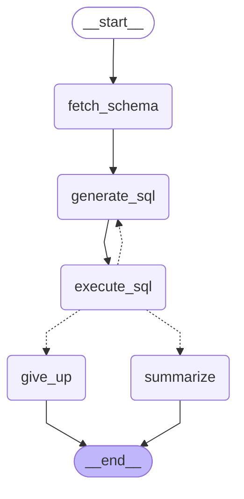

# Self-Healing SQL Agent

A production-grade, streaming-first **Text-to-SQL agent for PostgreSQL** built with **LangGraph**, **FastAPI**, **SQLAlchemy 2.x + asyncpg**, **sqlglot**, and **Pydantic v2**.

## 1. Why Self-Healing Matters

Even when an LLM is given a database schema upfront, first-attempt SQL queries fail in production due to subtle schema conventions (e.g., guessing `orders.created_at` when the table actually uses `orders.order_date`, date/timestamp casting mismatches, or grouping errors). Instead of returning a 500 error or hallucinating an answer, this agent:

1. **Always inspects the live PostgreSQL schema first** (`information_schema` + `pg_constraint`) before writing any SQL.
2. **Executes queries inside a multi-layered read-only sandbox.**
3. **Captures the exact PostgreSQL error message** on failure, feeds the failed SQL + error + schema back to the LLM, and repairs the query automatically (up to `MAX_ATTEMPTS`, default `3`).
4. **Streams every node transition live over Server-Sent Events (SSE)** so clients see schema inspection, each SQL attempt, any database error, the self-healed query, and the final answer in real time.

---

## 2. Architecture

Generated directly via `graph.get_graph().draw_mermaid()`:



### Routing logic after `execute_sql`
- **`execution_error is None`** -> `summarize` -> `END`
- **`execution_error is not None` and `iterations >= MAX_ATTEMPTS`** -> `give_up` -> `END`
- **`execution_error is not None` and `iterations < MAX_ATTEMPTS`** -> `generate_sql` (self-healing retry loop)

---

## 3. Self-Healing Log (`scripts/demo_self_heal.py`)

Running `uv run python scripts/demo_self_heal.py` against the seeded database produces:

```text
============================================================================
SELF-HEALING SQL AGENT DEMO
Question: "What was last month's revenue?"
============================================================================

[1. fetch_schema] Introspected 4 tables from public schema:
    Table customers:
    Table order_items:
    Table orders:
    Table products:

[2. generate_sql | Attempt 1]
    Thought : Join orders and order_items and filter last month's non-cancelled orders using o.created_at.
    SQL     : SELECT ROUND(SUM(oi.quantity * oi.unit_price), 2) AS revenue FROM orders o JOIN order_items oi ON oi.order_id = o.id WHERE o.created_at >= date_trunc('month', CURRENT_DATE - INTERVAL '1 month') AND o.created_at < date_trunc('month', CURRENT_DATE) AND o.status <> 'cancelled'

[3. execute_sql  | Attempt 1] -> FAILED
    Postgres Error: column o.created_at does not exist
    Action        : Routing back to generate_sql for self-healing...

[2. generate_sql | Attempt 2]
    Thought : PostgreSQL reported `column o.created_at does not exist`. Inspecting the fetched `orders` schema shows the date column is named `order_date` (type `date`). Replacing `o.created_at` with `o.order_date`.
    SQL     : SELECT ROUND(SUM(oi.quantity * oi.unit_price), 2) AS revenue FROM orders o JOIN order_items oi ON oi.order_id = o.id WHERE o.order_date >= date_trunc('month', CURRENT_DATE - INTERVAL '1 month')::date AND o.order_date < date_trunc('month', CURRENT_DATE)::date AND o.status <> 'cancelled'

[3. execute_sql  | Attempt 2] -> SUCCEEDED
    Rows returned : [{'revenue': 834.7}]

[4. summarize]
    Final Answer  : Last month's revenue was $834.70 across 7 non-cancelled orders (excluding 1 cancelled order).

============================================================================
```

---

## 4. Safety Model (Defense in Depth)

Every query passes through five independent safety layers in `db/init.sql` and `app/database.py`:

1. **Dedicated Least-Privilege Database Role (`sql_agent_ro`)**:
   - Created with `NOSUPERUSER NOCREATEDB NOCREATEROLE NOREPLICATION NOBYPASSRLS NOINHERIT`.
   - Granted `SELECT` only on the four e-commerce tables (`customers`, `products`, `orders`, `order_items`), with Row-Level Security (`FOR SELECT TO sql_agent_ro`) enabled and `default_transaction_read_only = on` at the role level.
2. **AST Validation via `sqlglot` (`validate_sql`)**:
   - Parses the query using `sqlglot`'s PostgreSQL dialect before touching the database.
   - Rejects empty strings and **multi-statement queries** (`len(statements) != 1`).
   - Requires the root AST node to be `SELECT` or a set operation (`UNION` / `INTERSECT` / `EXCEPT`, including `WITH ... SELECT` CTEs).
   - Walks the entire AST to block any `INSERT`, `UPDATE`, `DELETE`, `MERGE`, `CREATE`, `DROP`, `ALTER`, `TRUNCATE`, `COPY`, `SET`, `GRANT`, `REVOKE`, `INTO` (`SELECT ... INTO`), or `LOCK` (`FOR UPDATE`) node — catching data-modifying CTEs such as `WITH d AS (DELETE ...) SELECT * FROM d`.
   - Blocks dangerous or side-effecting PostgreSQL functions (`pg_sleep`, `set_config`, `pg_terminate_backend`, `pg_read_file`, `dblink`, `nextval`, `setval`, etc.).
   - Returns validation failures as standard error results (`status="error"`) so the agent can self-heal from them too.
3. **Per-Query Read-Only Transaction & Always-Rollback**:
   - Every query runs inside an explicit transaction that executes `SET TRANSACTION READ ONLY` and always rolls back in a `finally` block.
4. **Statement Timeout Enforcement**:
   - Configured both in connection `server_settings` and per transaction via `SET LOCAL statement_timeout = '<STATEMENT_TIMEOUT_MS>ms'` (default `5000ms`), ensuring enforcement even behind transaction poolers (PgBouncer / Supavisor).
5. **Bounded Row Fetch (`ROW_LIMIT`)**:
   - Uses `cursor.mappings().fetchmany(row_limit)` (default `50`) so a broad `SELECT` can never exhaust application or LLM context memory.

---

## 5. Quickstart

### Option A: Local PostgreSQL 16 via Docker Compose

```bash
cd self-healing-sql-agent

# 1. Start PostgreSQL 16 and automatically run db/init.sql
docker compose up -d

# 2. Configure environment variables
cp .env.example .env
# Edit .env and set LLM_API_KEY (and optionally LLM_PROVIDER / LLM_MODEL)
```

### Option B: Remote PostgreSQL / Supabase

```bash
cd self-healing-sql-agent

# 1. Seed the database once using an admin connection string
psql "$ADMIN_DATABASE_URL" -v ON_ERROR_STOP=1 -f db/init.sql

# 2. Configure .env to connect as the read-only role `sql_agent_ro`
cp .env.example .env
```

### Install dependencies and start the FastAPI server

```bash
uv sync
uv run uvicorn app.main:app --host 0.0.0.0 --port 8000
```

### Stream a query via `curl` (SSE)

```bash
curl -N -X POST http://localhost:8000/query/stream \
  -H "Content-Type: application/json" \
  -d '{"question": "What was last month'\''s revenue?"}'
```

Each SSE frame is formatted as `data: <json>\n\n` with a uniform schema:

```json
{"type":"node_update","node":"fetch_schema","attempt":null,"sql":null,"error":null,"thought_process":null,"answer":null}
{"type":"node_update","node":"generate_sql","attempt":1,"sql":"SELECT ...","error":null,"thought_process":"...","answer":null}
{"type":"node_update","node":"execute_sql","attempt":1,"sql":"SELECT ...","error":null,"thought_process":null,"answer":null}
{"type":"final","node":"summarize","attempt":1,"sql":"SELECT ...","error":null,"thought_process":null,"answer":"Last month's revenue was $834.70."}
{"type":"done","node":null,"attempt":1,"sql":null,"error":null,"thought_process":null,"answer":null}
```

---

## 6. Running the Tests

```bash
cd self-healing-sql-agent

# Run the full test suite (unit + live PostgreSQL integration tests)
uv run pytest -v

# Run only fast offline unit tests (no database required)
uv run pytest -m "not integration" -v

# Run the self-healing demonstration script
uv run python scripts/demo_self_heal.py

# Launch the interactive Terminal UI (or run `--demo` / `-q "question"`)
uv run python scripts/cli.py
uv run python scripts/cli.py --demo
```

---

## 7. Assumptions & Design Notes

1. **Relative Seed Dates**: `db/init.sql` computes `orders.order_date` relative to `current_date` (`date_trunc('month', current_date) + make_interval(months => offset)`), so _"What was last month's revenue?"_ always has deterministic data (`$834.70` across 7 non-cancelled orders, or `$1,232.70` if the 1 cancelled order is included) regardless of the calendar month when the database is initialized.
2. **Revenue Definition**: Non-cancelled orders (`status <> 'cancelled'`) are used as the standard e-commerce revenue definition.
3. **Transaction Pooler Compatibility**: `create_db_engine` disables asyncpg's prepared statement cache (`statement_cache_size=0`) and issues `SET TRANSACTION READ ONLY` + `SET LOCAL statement_timeout` inside each transaction so the agent works identically against both direct PostgreSQL (port `5432`) and Supavisor/PgBouncer transaction poolers (port `6543`).
4. **Constraint Introspection for Read-Only Roles**: Because PostgreSQL's `information_schema.constraint_column_usage` hides foreign keys from roles that only hold `SELECT` privilege, `fetch_db_schema` queries `information_schema.tables` / `information_schema.columns` for table and column metadata and `pg_catalog.pg_constraint` for primary and foreign key relationships.
